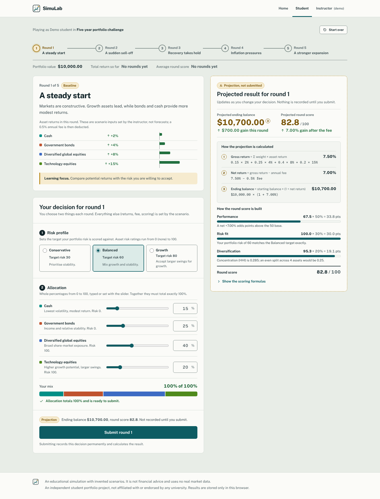
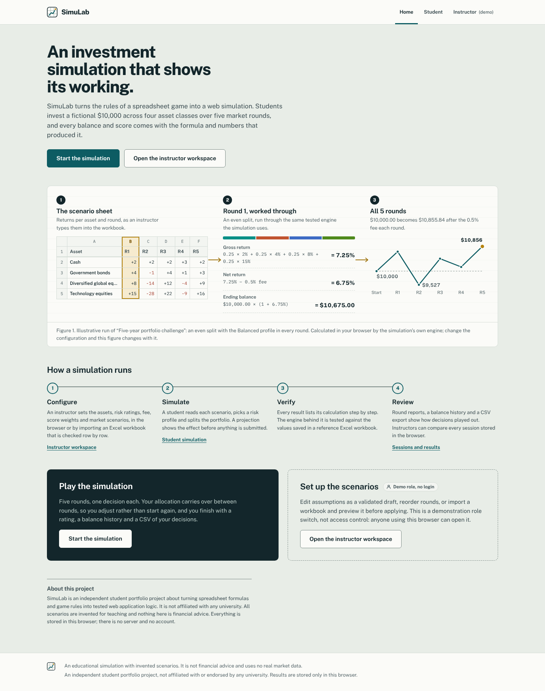
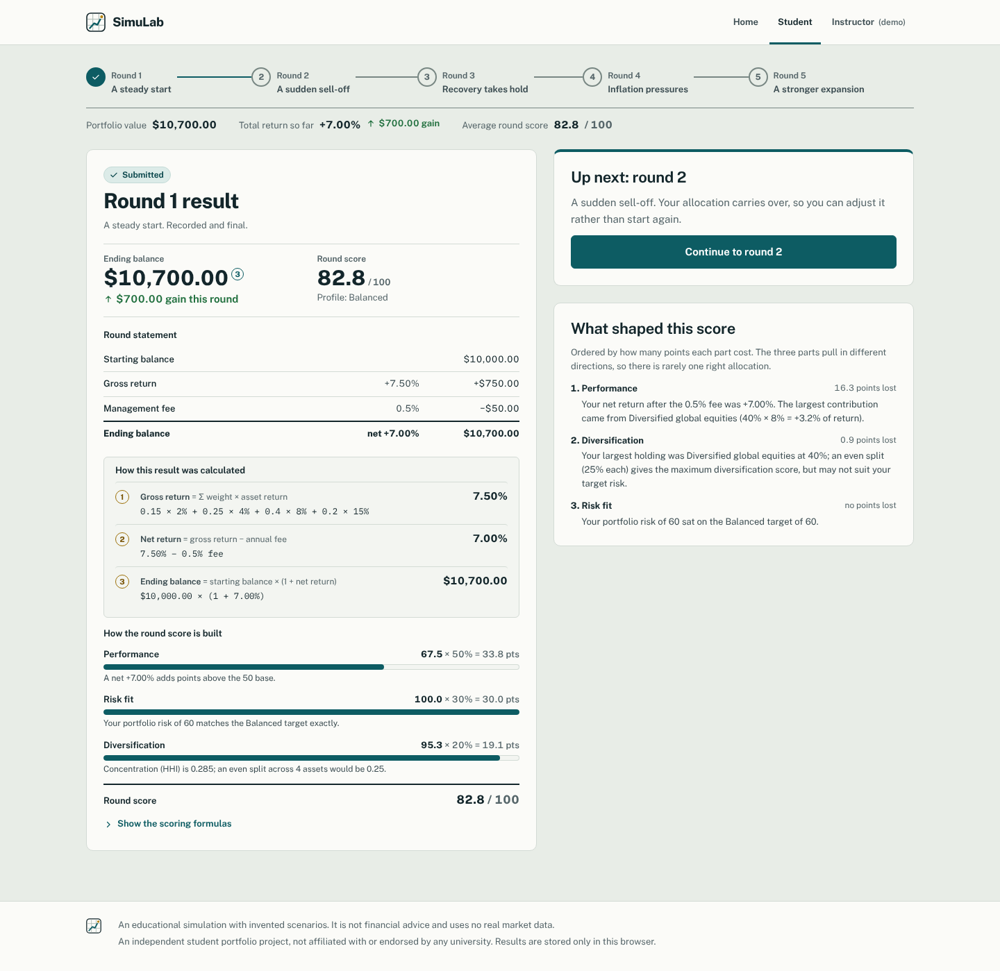
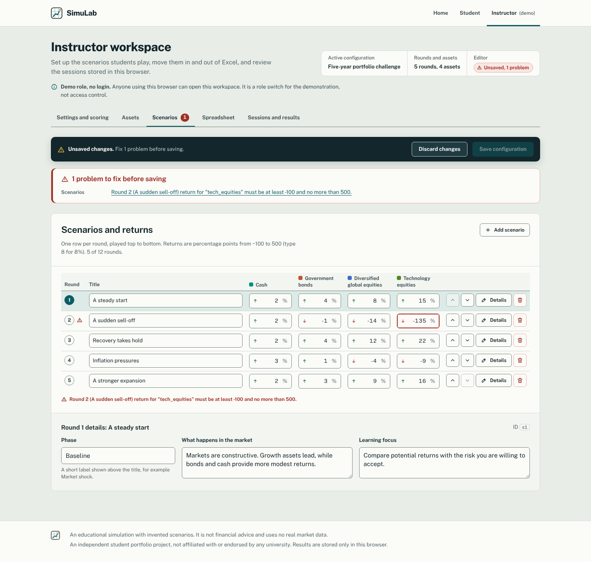
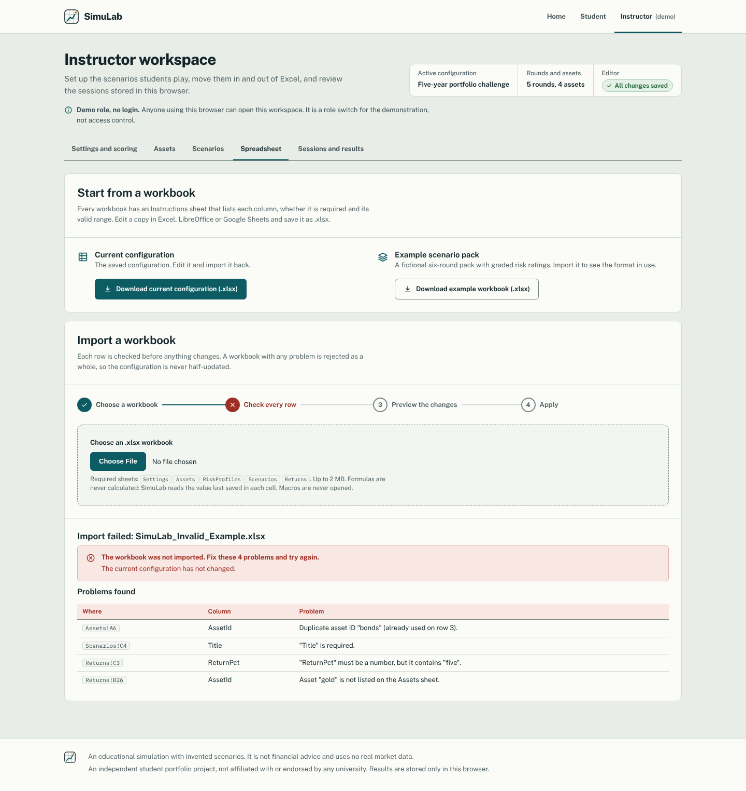
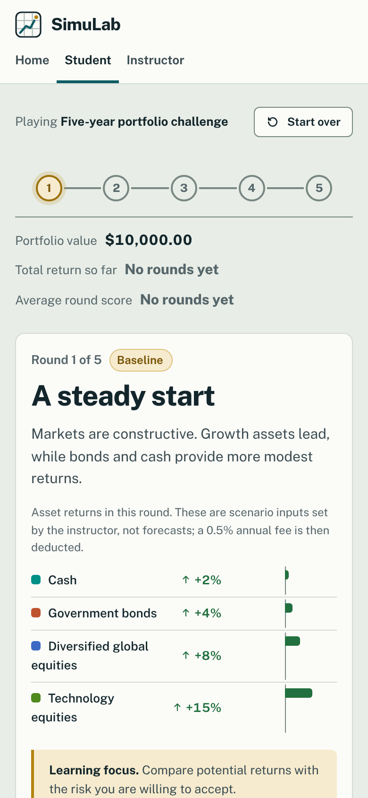

# SimuLab: Spreadsheet-to-Web Simulation Studio

SimuLab turns a small Excel-based investment game into a tested, responsive web application. Students play five market
rounds with a fictional A$10,000 portfolio and see the formula behind every number. Instructors change the scenarios,
returns, fees and scoring in the browser or through a documented Excel workbook, without touching code.

> **About this project.** SimuLab is an independent student portfolio project. It is not affiliated with, endorsed by or
> used by any university, and it has no real users. The scenarios are invented for teaching, and nothing in it is
> financial advice. The instructor view is a **demonstration role switch, not access control**.

It grew out of an earlier prototype, MarketLab (kept unchanged in `legacy/marketlab-prototype/`). The new calculation
engine is tested against the values saved in MarketLab's Excel reference workbook.



| Home | Round result | Instructor scenarios | Workbook import problems | Phone |
|---|---|---|---|---|
|  |  |  |  |  |

All twelve screenshots in `docs/screenshots/` are captured from the running app by `npm run screenshots`:
home, student start, a round with a valid allocation, the round result, round 2 with history, final results, the
instructor scenario matrix with a problem, import problems, import preview, sessions, and a phone view of a round
(screen and full page).

## Features

**Student experience**
- Five sequential rounds, four asset classes (cash, government bonds, diversified global equities, technology equities)
  and a starting balance of A$10,000, all configurable.
- A start screen that separates what the student decides (risk profile, allocation) from what the scenario sets.
- A round timeline, a scenario brief with the round's returns drawn as bars, and an allocation editor with a stacked
  bar and an explicit "100% of 100%" check.
- A live projection, marked "Projection, not submitted" with a dashed ochre border, uses the same engine as the recorded
  result.
- Each result reads like a short analyst's note: ending balance and score, a money statement (gross return, fee,
  ending balance), numbered calculation steps with the numbers substituted in, the three scores with reasons and
  formulas on request, and feedback ordered by the points each score component lost.
- Balance chart, round history, final rating, CSV export of your own results with a success or failure message.
- Interrupted sessions resume after a reload; a double click records one round; "Start over" needs confirmation.

**Instructor workspace (demo role)**
- A status header (active configuration, saved or unsaved) and a problem count on each tab.
- Edit settings, fee, score weights and parameters, risk profiles, assets and risk ratings, and a scenario return
  matrix (rounds as rows, assets as columns) with reordering.
- Edits are a validated draft; a validation summary lists every problem and jumps to the field; saving is blocked
  while anything is invalid. Running sessions keep the configuration they started with.
- Guided `.xlsx` import in four steps (choose, check, preview, apply): problems name the exact cell (for example
  `Returns!C3`); a valid workbook shows what would change before anything is applied; any problem rejects the whole
  file. Export the configuration back to Excel, and every session's results to CSV.
- Compare sessions in one table, view each one's rounds, delete them, or reset all demo data, each with confirmation.

**Engineering**
- Pure TypeScript calculation engine (`src/domain/`) with no UI dependencies.
- Explicit units and no rounding until display; documented in `docs/MODEL_SPEC.md`.
- Versioned browser storage; stored sessions are replayed through the engine and rejected if they do not match.
- Workbook formulas are never executed. CSV export guards against spreadsheet formula injection.
- Keyboard-operable; automated axe-core WCAG 2.1 A/AA checks and no-sideways-scroll checks at five screen widths in
  the browser tests.
- A small design system: every colour, size and timing is a token in `src/styles/tokens.css`; the reasons are in
  `docs/DESIGN_DECISIONS.md`.

## Technology

| Area | Choice |
|---|---|
| UI | React 19, strict TypeScript 5.9 |
| Build | Vite 7 |
| Charts | Recharts 3 |
| Spreadsheets | The project's own `.xlsx` reader and writer (`src/services/spreadsheets/ooxml/`) on `fflate` 0.8.3 for zip |
| Storage | `localStorage`, no backend |
| Tests | Vitest 5, React Testing Library, jsdom, Playwright 1.56, axe-core |
| Styling | Plain CSS with design tokens (`src/styles/tokens.css`); Public Sans and IBM Plex Mono, bundled (no external font requests); inline SVG icons |

## Requirements

- Node.js 22.12 or later on the 22.x line, or Node 24.x. Node 20 is **not** supported: the test runner (Vitest 5)
  requires `^22.12.0 || ^24.0.0 || >=26.0.0`. Check with `node --version`.
- Tested with Node 22.22.0 and npm 10.9.4 on Linux. The project has not been run on Windows or macOS by the author; the
  npm commands below are the same in PowerShell.
- For browser tests: Playwright's Chromium (`npx playwright install chromium`, one-off).

## Getting started

Run every command in the `simulab` folder, the one that contains `package.json` and `package-lock.json`. The zip
extracts to a `simulab` folder, and Windows' "Extract All" puts that inside another folder named after the zip (for
example `SimuLab\simulab`). Running `npm ci` one level too high fails with
`npm error code EUSAGE … can only install with an existing package-lock.json`.

```bash
npm ci                 # install the exact versions in package-lock.json
npm run dev            # development server, http://localhost:5173
npm run build          # typecheck and production build into dist/
npm run preview        # serve dist/ at http://localhost:4173
```

## Testing

```bash
npm run typecheck      # strict TypeScript
npm test               # Vitest: unit, integration and component tests
npm run test:e2e       # Playwright: builds, serves on port 4173 and runs browser tests in Chromium
npm run test:all       # all of the above in order
npm run screenshots    # recapture docs/screenshots/ from the running app
node --test legacy/marketlab-prototype/tests/simulation.test.mjs   # the original prototype's tests
```

Last recorded run (15 October 2026, fresh copy of the project, clean `npm ci`, Node 22.22.0):

| Check | Result |
|---|---|
| `npm run typecheck` | passed (exit code 0) |
| `npm test` | 18 files, **216 of 216 tests passed** |
| `npm run build` | succeeded |
| `npm run test:e2e` | **25 of 25 tests passed** (desktop and mobile Chromium) |
| `npm run screenshots` | passed; 12 images written |
| Legacy prototype tests | 10 of 10 passed |
| `npm audit` | 0 vulnerabilities |

Code coverage and performance were **not** measured. `docs/TESTING.md` explains what each layer covers and what is not
tested.

## Using the spreadsheet template

1. Download `samples/SimuLab_Template.xlsx` (or use **Instructor workspace → Spreadsheet → Download current
   configuration**).
2. Read its **Instructions** sheet. It is generated from the same schema the importer uses.
3. Edit the Settings, Assets, RiskProfiles, Scenarios and Returns sheets. Returns are in percentage points (`8` means 8%).
4. Import it under **Spreadsheet → Import a workbook**, check the preview of what will change, then **Apply
   configuration**.

| Sample | Purpose |
|---|---|
| `samples/SimuLab_Template.xlsx` | The default configuration |
| `samples/SimuLab_Example_RateCycle.xlsx` | A fictional 6-round pack with A$25,000, a 0.75% fee and graded risk ratings |
| `samples/SimuLab_Invalid_Example.xlsx` | Four deliberate mistakes, to see cell-level errors |

Regenerate them with `npm run gen:workbooks`. The full format is in `docs/MODEL_SPEC.md`.

## Deployment

The build is a static site with hash-based routes (`#/student`, `#/instructor/...`), so any static host works with no
rewrite rules: upload `dist/`.

- **Sub-path hosting:** set `BASE_PATH`, for example `BASE_PATH=/simulab/ npm run build` (macOS/Linux) or
  `$env:BASE_PATH="/simulab/"; npm run build` (PowerShell). In PowerShell the variable stays set for the whole window, so
  clear it afterwards with `Remove-Item Env:BASE_PATH`; otherwise later builds, including the one `npm run test:e2e`
  makes, also use the sub-path and the browser tests fail. A local check on Linux confirmed that a build with
  `BASE_PATH=/simulab/` serves its page and scripts under `/simulab/`.
- **GitHub Pages:** `.github/workflows/deploy-pages.yml` builds with `BASE_PATH=/<repository-name>/` and deploys. Set the
  repository's Pages source to "GitHub Actions" first.
- **CI:** `.github/workflows/ci.yml` runs the typecheck, Vitest, the build, the legacy tests and Playwright.

Both workflows were written but **have not been run on GitHub**, and the app has not been deployed from this environment.

## Project structure

```
src/
  domain/        pure calculation engine: types, constants, validation, calculations, scoring, progression, explain
  data/          default and example configurations
  services/      persistence (localStorage), spreadsheets (import/export and the ooxml/ .xlsx reader and writer), CSV export
  app/           store (framework-free), React binding, hash router, App shell
  features/      home, student and instructor screens
  components/    shared UI (icons, logo, dialogs, notices, inputs, error boundary) and viz/ (allocation and return bars)
  styles/        tokens.css, base, layout, components, and one stylesheet per area
tests/           unit, integration, component, e2e, screenshots, fixtures
samples/         template, example and invalid workbooks
scripts/         workbook generator
docs/            specification, architecture, testing, guides, screenshots
legacy/          the original MarketLab prototype, unchanged
```

## Documentation

| Document | Contents |
|---|---|
| [`docs/MODEL_SPEC.md`](docs/MODEL_SPEC.md) | Formulas, units, validation rules, workbook format, worked examples |
| [`docs/ARCHITECTURE.md`](docs/ARCHITECTURE.md) | Layers, modules, data flow, error handling, security notes, adding a server |
| [`docs/MIGRATION_FROM_MARKETLAB.md`](docs/MIGRATION_FROM_MARKETLAB.md) | What changed from the prototype and why; parity method |
| [`docs/TESTING.md`](docs/TESTING.md) | Test layers, commands, recorded results, known gaps |
| [`docs/USER_GUIDE.md`](docs/USER_GUIDE.md) | How students and instructors use the app and the workbook |
| [`docs/INTERVIEW_GUIDE.md`](docs/INTERVIEW_GUIDE.md) | Design decisions and trade-offs, explained |
| [`docs/DEMO_SCRIPT.md`](docs/DEMO_SCRIPT.md) | A five-minute demo walkthrough |
| [`docs/DESIGN_DECISIONS.md`](docs/DESIGN_DECISIONS.md) | The visual system: colour meanings and measured contrast, type, layout, icons, accessibility choices |
| [`docs/REDESIGN_GUIDE_FOR_KARTAVYA.md`](docs/REDESIGN_GUIDE_FOR_KARTAVYA.md) | Plain-language guide to the redesign: key files, changing tokens, the SVG artwork, commands, what to study |

## Known issues and limitations

- **Spreadsheet compatibility.** SheetJS (`xlsx@0.18.5`, which had two unfixed high-severity advisories on npm) was
  replaced by the project's own `.xlsx` reader and writer; `npm audit` now reports 0 vulnerabilities. The reader is
  tested against files written by openpyxl and re-saved by LibreOffice Calc, plus the original MarketLab workbook.
  Workbooks saved by current Microsoft Excel and by Google Sheets have **not** been tested. It reads only what SimuLab
  needs: cell values and number formats, not styles, charts or formulas (formulas are never calculated).
- **No real access control.** The instructor view is open to anyone using the browser.
- **One browser only.** Data lives in `localStorage` on one device. Two tabs open at once may overwrite each other's changes
  (not handled, not tested). Only the 50 most recent sessions are kept; older ones are removed without a warning.
- **Scores can be forged** by anyone who edits browser storage carefully enough; replay verification catches inconsistent
  edits, not deliberate ones. A server would be needed for assessment use.
- **Testing gaps.** Browser tests ran in Chromium only; no screen reader was used; phone and tablet widths were emulated,
  not tested on real devices; no coverage or performance measurement.
- **Design gaps.** There is no dark theme. On phones the scenario return matrix scrolls sideways inside its box.
  Validation messages for returns name assets by their ID (for example `"tech_equities"`) rather than their name.
- **Floating-point arithmetic.** Money uses JavaScript numbers with rounding only for display, which suits a teaching model
  but would not be the choice for real money.
- **Bundle.** Recharts (91 KB gzipped) loads on the first page although only the student screens draw a chart.

## Licence

No licence has been chosen yet. All rights reserved by the author until one is added.
