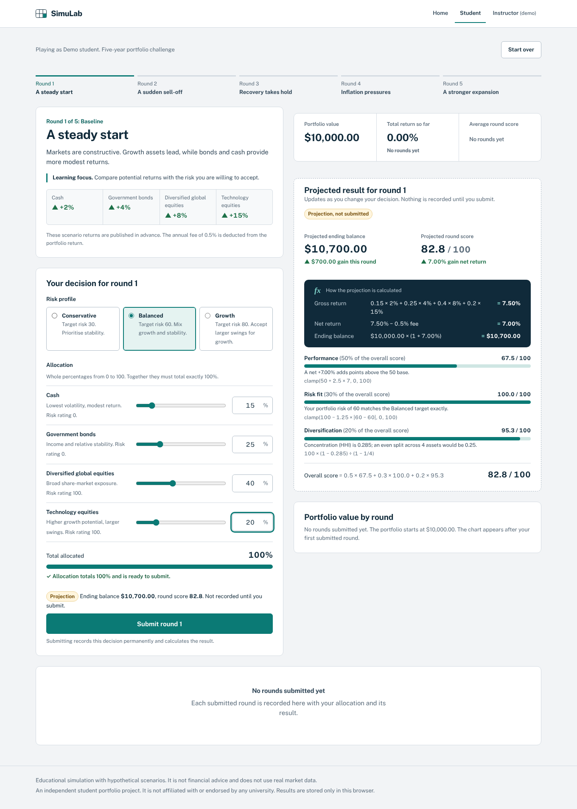
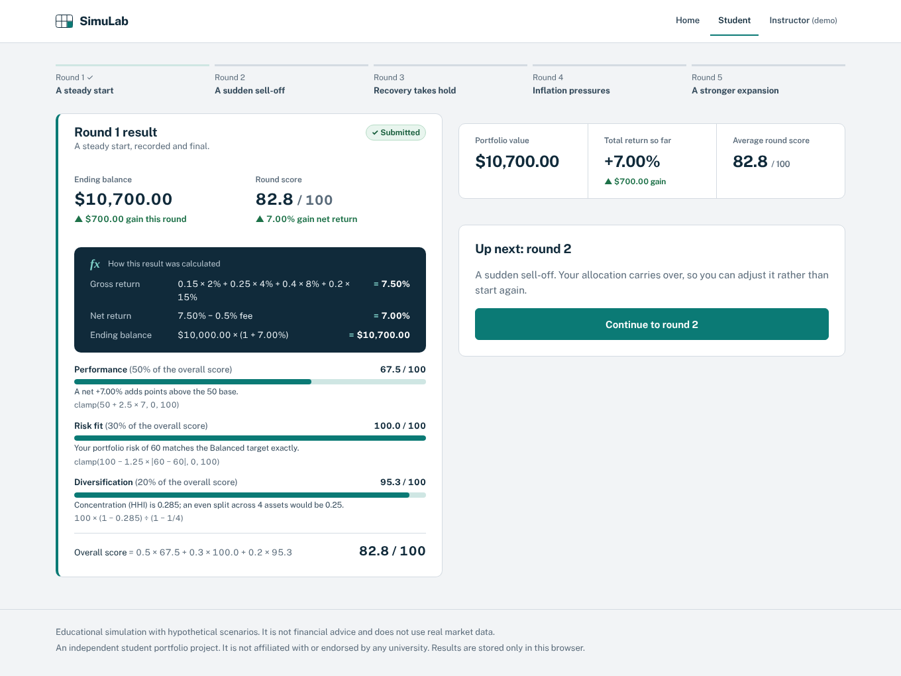
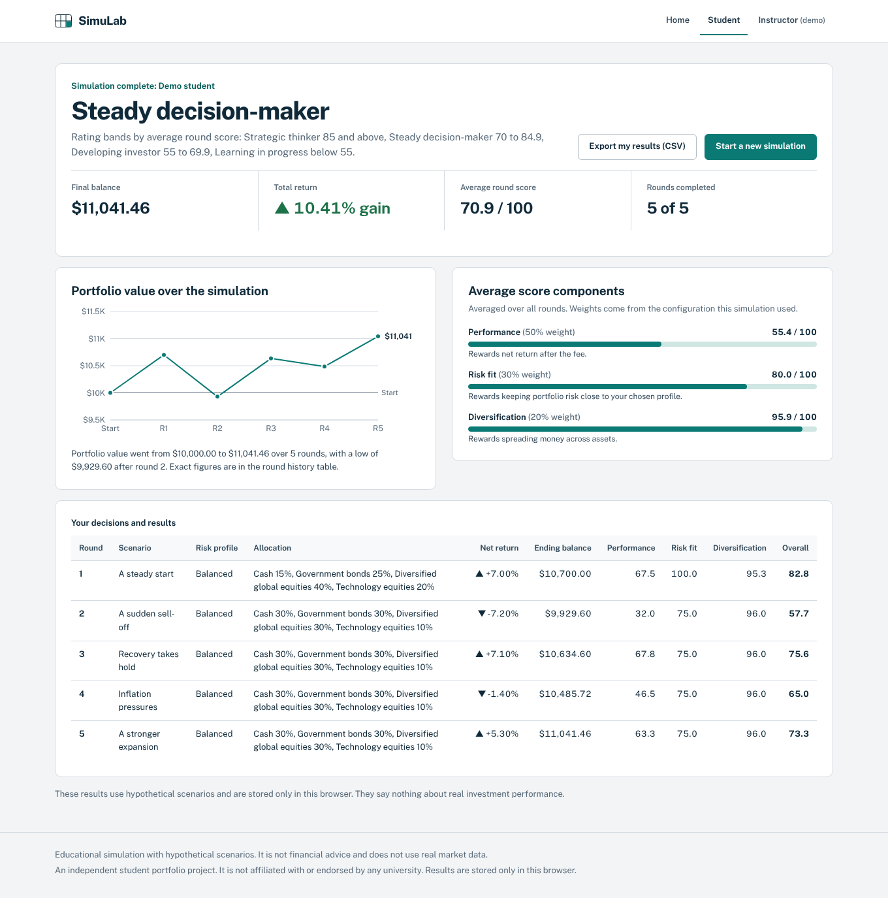
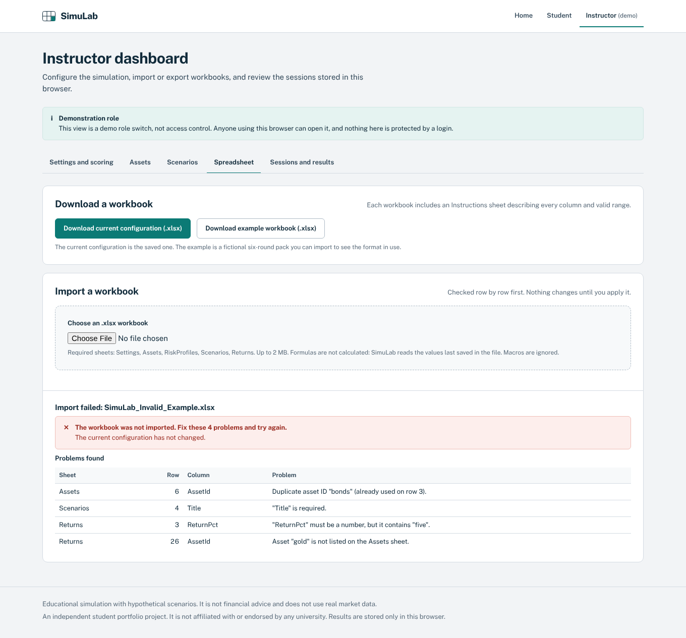
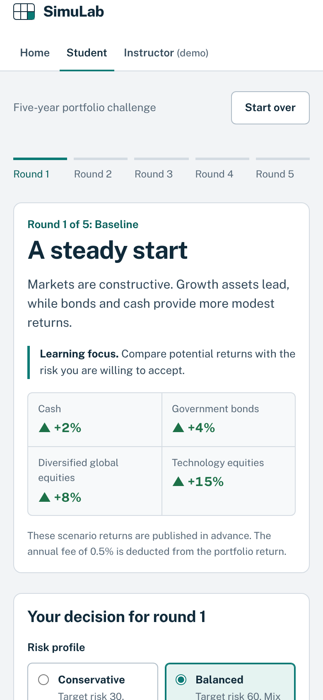

# SimuLab: Spreadsheet-to-Web Simulation Studio

SimuLab turns a small Excel-based investment game into a tested, responsive web application. Students play five market
rounds with a fictional A$10,000 portfolio and see the formula behind every number. Instructors change the scenarios,
returns, fees and scoring in the browser or through a documented Excel workbook, without touching code.

> **About this project.** SimuLab is an independent student portfolio project. It is not affiliated with, endorsed by or
> used by any university, and it has no real users. The scenarios are invented for teaching, and nothing in it is
> financial advice. The instructor view is a **demonstration role switch, not access control**.

It grew out of an earlier prototype, MarketLab (kept unchanged in `legacy/marketlab-prototype/`). The new calculation
engine is tested against the values saved in MarketLab's Excel reference workbook.



| Round result | Final results | Workbook import errors | Phone |
|---|---|---|---|
|  |  |  |  |

All ten screenshots in `docs/screenshots/` are captured from the running app by `npm run screenshots`.

## Features

**Student experience**
- Five sequential rounds, four asset classes (cash, government bonds, diversified global equities, technology equities)
  and a starting balance of A$10,000, all configurable.
- Choose a risk profile and allocate whole-number percentages that must total exactly 100%, with messages beside the fields.
- A live projection, clearly labelled as not submitted, uses the same engine as the recorded result.
- Each result shows gross return, management fee, net return, ending balance and three scores (performance, risk fit,
  diversification), each with its formula and the numbers substituted in.
- Balance chart, round history, final rating, CSV export of your own results.
- Interrupted sessions resume after a reload; a double click records one round; "Start over" needs confirmation.

**Instructor dashboard (demo role)**
- Edit settings, fee, score weights and parameters, risk profiles, assets and risk ratings, scenarios, round order and returns.
- Edits are a validated draft with field-level messages; saving is blocked while anything is invalid.
- Running sessions keep the configuration they started with.
- Import an `.xlsx` workbook: validated row by row, previewed, applied only after confirmation; any problem rejects the whole
  file. Export the configuration back to Excel, and every session's results to CSV.
- Review sessions, delete them, or reset all demo data, each with confirmation.

**Engineering**
- Pure TypeScript calculation engine (`src/domain/`) with no UI dependencies.
- Explicit units and no rounding until display; documented in `docs/MODEL_SPEC.md`.
- Versioned browser storage; stored sessions are replayed through the engine and rejected if they do not match.
- Workbook formulas are never executed. CSV export guards against spreadsheet formula injection.
- Keyboard-operable; automated axe-core WCAG 2.1 A/AA checks in the browser tests.

## Technology

| Area | Choice |
|---|---|
| UI | React 19, strict TypeScript 5.9 |
| Build | Vite 7 |
| Charts | Recharts 3 |
| Spreadsheets | SheetJS (`xlsx` 0.18.5 from npm; see known issues) |
| Storage | `localStorage`, no backend |
| Tests | Vitest 5, React Testing Library, jsdom, Playwright 1.56, axe-core |
| Styling | Plain CSS with design tokens (`src/styles/tokens.css`), Public Sans (bundled, no external font requests) |

## Requirements

- Node.js 22.12 or later on the 22.x line, or Node 24.x. Node 20 is **not** supported: the test runner (Vitest 5)
  requires `^22.12.0 || ^24.0.0 || >=26.0.0`. Check with `node --version`.
- Tested with Node 22.22.0 and npm 10.9.4 on Linux. The project has not been run on Windows or macOS by the author; the
  npm commands below are the same in PowerShell.
- For browser tests: Playwright's Chromium (`npx playwright install chromium`, one-off).

## Getting started

Run every command in the `simulab` folder, the one that contains `package.json` and `package-lock.json`. The zip
extracts to a `simulab` folder, and Windows' "Extract All" puts that inside another folder named after the zip (for
example `SimuLab\simulab`). Running `npm ci` one level too high fails with
`npm error code EUSAGE … can only install with an existing package-lock.json`.

```bash
npm ci                 # install the exact versions in package-lock.json
npm run dev            # development server, http://localhost:5173
npm run build          # typecheck and production build into dist/
npm run preview        # serve dist/ at http://localhost:4173
```

## Testing

```bash
npm run typecheck      # strict TypeScript
npm test               # Vitest: unit, integration and component tests
npm run test:e2e       # Playwright: builds, serves on port 4173 and runs browser tests in Chromium
npm run test:all       # all of the above in order
node --test legacy/marketlab-prototype/tests/simulation.test.mjs   # the original prototype's tests
```

Last recorded run (15 October 2026, clean `npm ci`, Node 22.22.0):

| Check | Result |
|---|---|
| `npm run typecheck` | passed (exit code 0) |
| `npm test` | 15 files, **167 of 167 tests passed** |
| `npm run build` | succeeded |
| `npx playwright test` | **14 of 14 tests passed** (desktop and mobile Chromium) |
| Legacy prototype tests | 10 of 10 passed |
| `npm audit` | 1 high-severity advisory (`xlsx`, see below) |

Code coverage and performance were **not** measured. `docs/TESTING.md` explains what each layer covers and what is not
tested.

## Using the spreadsheet template

1. Download `samples/SimuLab_Template.xlsx` (or use **Instructor dashboard → Spreadsheet → Download a workbook**).
2. Read its **Instructions** sheet. It is generated from the same schema the importer uses.
3. Edit the Settings, Assets, RiskProfiles, Scenarios and Returns sheets. Returns are in percentage points (`8` means 8%).
4. Import it under **Spreadsheet → Import a workbook**, check the preview, then **Apply configuration**.

| Sample | Purpose |
|---|---|
| `samples/SimuLab_Template.xlsx` | The default configuration |
| `samples/SimuLab_Example_RateCycle.xlsx` | A fictional 6-round pack with A$25,000, a 0.75% fee and graded risk ratings |
| `samples/SimuLab_Invalid_Example.xlsx` | Four deliberate mistakes, to see row-level errors |

Regenerate them with `npm run gen:workbooks`. The full format is in `docs/MODEL_SPEC.md`.

## Deployment

The build is a static site with hash-based routes (`#/student`, `#/instructor/...`), so any static host works with no
rewrite rules: upload `dist/`.

- **Sub-path hosting:** set `BASE_PATH`, for example `BASE_PATH=/simulab/ npm run build` (macOS/Linux) or
  `$env:BASE_PATH="/simulab/"; npm run build` (PowerShell). In PowerShell the variable stays set for the whole window, so
  clear it afterwards with `Remove-Item Env:BASE_PATH`; otherwise later builds, including the one `npm run test:e2e`
  makes, also use the sub-path and the browser tests fail. A local check on Linux confirmed that a build with
  `BASE_PATH=/simulab/` serves its page and scripts under `/simulab/`.
- **GitHub Pages:** `.github/workflows/deploy-pages.yml` builds with `BASE_PATH=/<repository-name>/` and deploys. Set the
  repository's Pages source to "GitHub Actions" first.
- **CI:** `.github/workflows/ci.yml` runs the typecheck, Vitest, the build, the legacy tests and Playwright.

Both workflows were written but **have not been run on GitHub**, and the app has not been deployed from this environment.

## Project structure

```
src/
  domain/        pure calculation engine: types, constants, validation, calculations, scoring, progression, explain
  data/          default and example configurations
  services/      persistence (localStorage), spreadsheets (SheetJS import/export), CSV export
  app/           store (framework-free), React binding, hash router, App shell
  features/      home, student and instructor screens
  components/    shared UI (dialogs, notices, inputs, error boundary)
  styles/        tokens.css and app.css
tests/           unit, integration, component, e2e, screenshots, fixtures
samples/         template, example and invalid workbooks
scripts/         workbook generator
docs/            specification, architecture, testing, guides, screenshots
legacy/          the original MarketLab prototype, unchanged
```

## Documentation

| Document | Contents |
|---|---|
| [`docs/MODEL_SPEC.md`](docs/MODEL_SPEC.md) | Formulas, units, validation rules, workbook format, worked examples |
| [`docs/ARCHITECTURE.md`](docs/ARCHITECTURE.md) | Layers, modules, data flow, error handling, security notes, adding a server |
| [`docs/MIGRATION_FROM_MARKETLAB.md`](docs/MIGRATION_FROM_MARKETLAB.md) | What changed from the prototype and why; parity method |
| [`docs/TESTING.md`](docs/TESTING.md) | Test layers, commands, recorded results, known gaps |
| [`docs/USER_GUIDE.md`](docs/USER_GUIDE.md) | How students and instructors use the app and the workbook |
| [`docs/INTERVIEW_GUIDE.md`](docs/INTERVIEW_GUIDE.md) | Design decisions and trade-offs, explained |
| [`docs/DEMO_SCRIPT.md`](docs/DEMO_SCRIPT.md) | A five-minute demo walkthrough |

## Known issues and limitations

- **SheetJS advisory.** `npm audit` reports a high-severity advisory for `xlsx@0.18.5` (prototype pollution and ReDoS when
  parsing crafted files: GHSA-4r6h-8v6p-xvw6, GHSA-5pgg-2g8v-p4x9). There is no fixed version on the npm registry; SheetJS
  publishes fixed versions from its own CDN. The likely upgrade is
  `npm install https://cdn.sheetjs.com/xlsx-0.20.3/xlsx-0.20.3.tgz` (check docs.sheetjs.com for the current version), followed by the full test
  suite. **This upgrade was not tried**: the CDN was unreachable from the build environment. Mitigations in place: parsing
  happens only in the user's own browser on a file they chose, files over 2 MB are rejected before parsing, sheets are
  limited to 500 rows and 20 columns, and SheetJS is loaded only by the instructor dashboard.
- **No real access control.** The instructor view is open to anyone using the browser.
- **One browser only.** Data lives in `localStorage` on one device. Two tabs open at once may overwrite each other's changes
  (not handled, not tested). Only the 50 most recent sessions are kept; older ones are removed without a warning.
- **Scores can be forged** by anyone who edits browser storage carefully enough; replay verification catches inconsistent
  edits, not deliberate ones. A server would be needed for assessment use.
- **Testing gaps.** Browser tests ran in Chromium only; no screen reader was used; generated workbooks were checked with
  SheetJS, not opened in Excel; no coverage or performance measurement.
- **Floating-point arithmetic.** Money uses JavaScript numbers with rounding only for display, which suits a teaching model
  but would not be the choice for real money.
- **Bundle.** Recharts (91 KB gzipped) loads on the home page although only the student screens draw a chart.

## Licence

No licence has been chosen yet. All rights reserved by the author until one is added.
